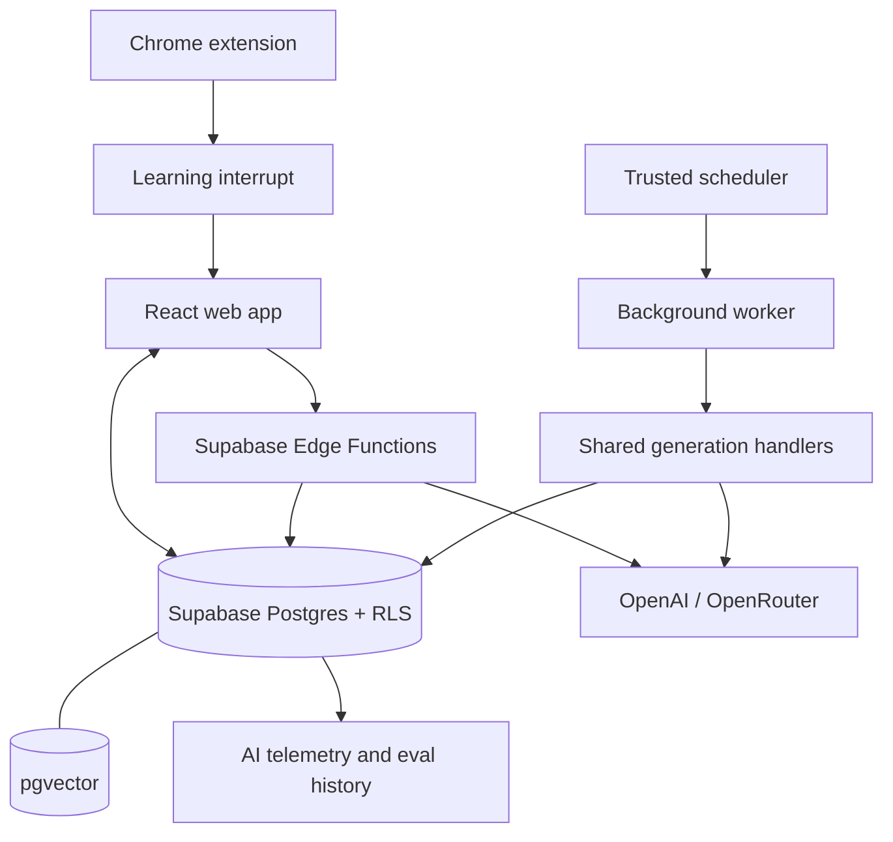
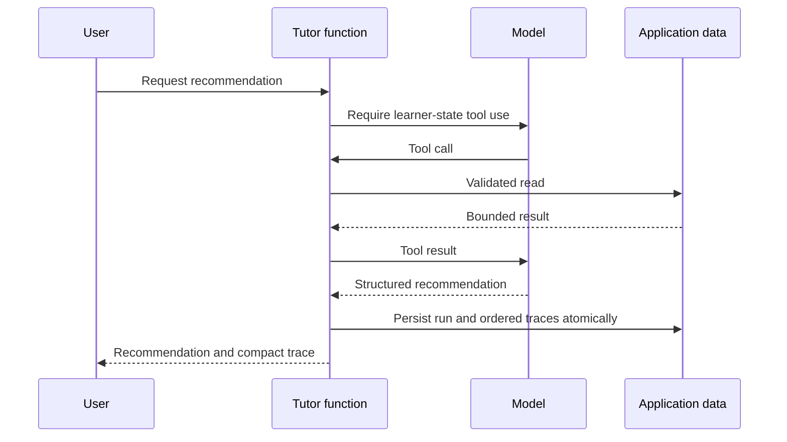
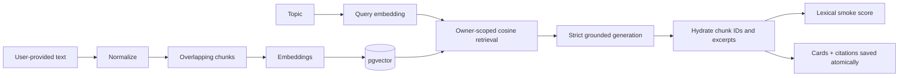
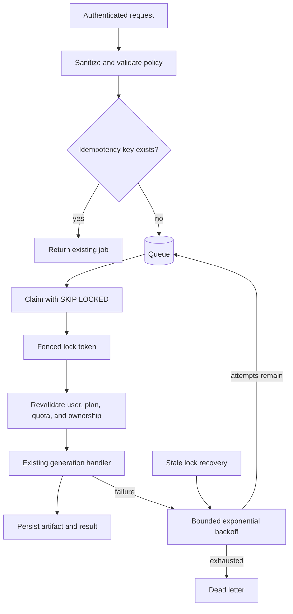

# Architecture

This document describes repository behavior. Supabase migrations and Edge Functions must be deployed before hosted paths exist.

## Application

The browser uses a user JWT and RLS. Edge Functions validate that JWT for synchronous requests. Derived data and operational state such as embeddings, generation events, tutor traces, and job transitions are written with the service role through narrowly granted SQL functions where atomicity matters.

## Adaptive tutor

The runtime permits three model rounds and eight total calls. Tool names and argument schemas are closed sets. The first round must call a tool, so the recommendation cannot present uninspected learner state as personalized evidence.

## Retrieval-augmented generation

Model output refers to retrieved positions. The server validates every index, then replaces it with stored chunk identity, excerpt, source title, URL metadata, and similarity. Every card needs at least one citation. Arbitrary URLs are never fetched by the Edge Function.

## Background generation

Jobs store `user_id` and a sanitized payload; they never store a browser access token or provider key. A worker secret authenticates the scheduler and an internal service identity selects the target user. The same card, grounded-card, and brief handlers serve synchronous and worker requests, keeping their authoritative generation rules on one path. Completion and failure RPCs require the job ID, worker ID, and current lock token, so an expired worker cannot overwrite a later claim.

## Data ownership

- Browser-managed product tables use owner RLS.
- Mastery is derived by a review trigger; clients cannot edit the aggregate.
- Source chunks and grounded telemetry are browser read-only.
- Feedback uses composite foreign keys so a user cannot attach feedback to another user's card or source.
- Tutor and queue state are owner-readable and service-writable.
- Vector retrieval either derives the browser owner from `auth.uid()` or accepts a user ID only in a service-role-only function.

## Quality signals

Runtime telemetry answers operational questions: requests, status, latency, tokens, known cost, grounding smoke score, tutor tools, and failures. Offline eval reports answer repeatable comparison questions. Correctness, relevance, retrieval recall, and faithfulness remain separate measures; no single runtime score is treated as proof of factual accuracy.
